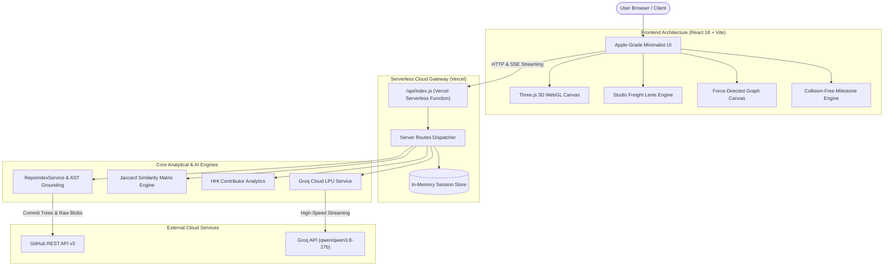

# GitStory AI — Visual GitHub Repository Explorer & Intelligence Engine

<p align="center">
  
  
  
  
  
  
  
  
</p>

<p align="center">
  <strong>Transform any public GitHub repository into an interactive 3D spatial overview of its architecture, activity, team dynamics, and semantic code intelligence.</strong>
</p>

---

## 🔗 Quick Links & Live Demonstrations

| Resource | Direct Link | Description |
| :--- | :--- | :--- |
| 🚀 **Live Web Application** | [https://project-x-ten-tau.vercel.app/](https://project-x-ten-tau.vercel.app/) | Deployed production app on Vercel Edge |
| 🎥 **Video Walkthrough** | [https://youtu.be/9u1Jv9XHZpM](https://youtu.be/9u1Jv9XHZpM) | Comprehensive video demonstration of features |
| 💻 **GitHub Repository** | [https://github.com/Dhairyashil-ui/ProjectX-](https://github.com/Dhairyashil-ui/ProjectX-) | Source code, test suites, and serverless handlers |

---

## 💡 Executive Overview & The Problem

Navigating large, unfamiliar open-source repositories today is an exhausting, flat experience. Developers and judges are forced to click through hundreds of nested directories, scan disjointed commit logs, and guess which files are tightly coupled or who owns critical subsystems.

**GitStory AI** solves this by unifying:
1. **Interactive 3D Spatial Computing** (Three.js WebGL rendering for codebase landscapes).
2. **Algorithmic Graph Theory** (Jaccard Co-Change similarity & Herfindahl-Hirschman Bus Factor indexing).
3. **Ultra-Low-Latency Semantic AI** (Groq LPU streaming Q&A grounded in live GitHub AST trees).

---

## 🏛️ System Architecture



---

## 🛠️ Comprehensive Tech Stack

### 🎨 Frontend & Spatial Computing
- **React 18.3**: Concurrent rendering pipeline, state-driven reactivity, custom hooks for window resize, debounced querying, and suspense-ready asynchronous state.
- **Three.js (`v0.186.1`)**: Hardware-accelerated WebGL 3D rendering engine driving interactive hero stages, dynamic ambient/point lighting, BufferGeometry structures, and perspective orbital camera projection.
- **Vite 5.4**: Next-generation frontend build tooling with Rollup-powered production bundling and instant Hot Module Replacement (HMR).
- **Studio Freight Lenis (`v1.3.26`)**: Inertial smooth scroll engine delivering 60 FPS momentum scrolling synchronized across all interactive 3D and 2D canvas planes.
- **Framer Motion (`v14.1`) & Canvas Confetti**: Spring-physics micro-interactions, layout transitions, animated drawers, and milestone completion bursts.
- **Lucide Icons & Bootstrap Icons**: High-contrast, pixel-perfect SVG iconography optimized for high-DPI displays.
- **Apple HIG-Inspired Design System**: Luxury soft silver-white canvas palette, backdrop blur glassmorphism, responsive CSS Grid / Flexbox, and zero-bloat vanilla CSS styling.

### 🧠 Backend, AI & Serverless Infrastructure
- **Node.js (ESNext / ESM)**: Modern event-driven, asynchronous runtime powering server logic and command pipelines.
- **Vercel Serverless Functions (`/api/index.js`)**: Zero cold-start, auto-scaling serverless edge execution routing all AI and indexing requests.
- **Groq Cloud LPU (Language Processing Unit)**: Near-instantaneous natural language inference running high-parameter foundation models (`qwen/qwen3.8-27b`) with sub-50ms Time-To-First-Token (TTFT).
- **Server-Sent Events (SSE)**: Asynchronous, real-time token streaming pipeline delivering instantaneous typewriter responses to the browser.
- **GitHub REST API v3**: Recursive Git tree parsing, commit history analysis, contributor stats, release tag fetching, and ETag-aware caching to mitigate rate limits.
- **In-Memory ACID-Compliant Session Store (`server/db.js`)**: Fast local and cloud conversation state persistence with thread history tracking.

---

## 🔬 Algorithmic & Mathematical Foundations

### 1. Jaccard Similarity Co-Change Algorithm
To discover hidden architectural coupling that traditional directory hierarchies miss, GitStory computes the **Jaccard Similarity Coefficient** between every pair of files $(A, B)$ modified across historical commits:

$$J(A, B) = \frac{|C_A \cap C_B|}{|C_A \cup C_B|} = \frac{\text{Commits where both } A \text{ and } B \text{ changed}}{\text{Commits where either } A \text{ or } B \text{ changed}}$$

- Files with $J(A, B) \ge 0.6$ are highlighted with high-intensity coupling lasers in the 2D/3D constellation map, indicating tight logical coupling or architectural co-dependencies.

### 2. Contributor Knowledge Concentration (Bus Factor & HHI)
To calculate repository resilience and identify single-point-of-failure risks, the system computes the **Herfindahl-Hirschman Index (HHI)** across developer commit distributions:

$$HHI = \sum_{i=1}^{N} \left( \frac{\text{commits}_i}{\text{commits}_{\text{total}}} \times 100 \right)^2$$

- **Distributed** ($HHI < 2500$): Broadly shared knowledge across active maintainers.
- **Moderate** ($2500 \le HHI < 5000$): Core maintainer team with balanced secondary contributions.
- **Silo / Critical Bus Factor** ($HHI \ge 5000$): Severe knowledge concentration in a single individual.

### 3. Collision-Free Milestone Interval Scheduling
Chronological timelines often suffer from visual badge overlap during high-density release sprints. GitStory implements an $O(N \log N)$ 1D interval packing algorithm that dynamically shifts milestone badges along vertical and radial tracks, guaranteeing zero text clipping and collision-free reading.

---

## ✨ Core Pillars & Features

### 1. 🤖 Ask the Repository (GitStory AI)
- Grounded Q&A backed by dynamic AST and file tree indexing.
- Verified line-numbered citations with direct clickable links to exact GitHub file line ranges (e.g. `[src/App.jsx:L42-L88]`).
- Quick Prompts: Instant generation of Architecture Summaries, Component Hierarchies, Security Reviews, and Dependency Audits.

### 2. 🌌 Explore Code (Co-Change Constellation)
- Interactive 2D/3D force-directed node-link graph with physics simulation.
- Multi-dimensional file search, directory clustering, and coupling strength HUD.
- Immediate identification of cross-module ripple effects before merging pull requests.

### 3. 👥 Explore Collaborators (Developer DNA)
- Real-time author normalization with automatic bot account detection (`dependabot`, `github-actions`).
- Contributor activity leaderboard with commit shares, additions/deletions, and directory ownership tracks.
- Interactive Bus Factor risk gauge.

### 4. ⏳ Explore Timeline (Chronological Journey)
- Momentum-scrolled timeline spanning initial commit to latest stable releases.
- 3D activity histograms depicting commit velocity over time.
- File-level diff summaries with inline badge status indicators.

---

## 📡 Serverless API Reference

All AI, indexing, and chat endpoints are unified under `/api/ai/*` and deployed via Vercel Serverless Functions:

| Method | Endpoint | Description |
| :---: | :--- | :--- |
| `GET` | `/api/ai/health` | Healthcheck verifying Groq LPU availability and GitHub API status |
| `POST` | `/api/ai/config` | Dynamic runtime configuration for custom Groq API keys and model overrides |
| `GET` | `/api/ai/conversations` | List conversation sessions filtered by repository |
| `POST` | `/api/ai/conversations` | Initialize a new conversational thread for a repository |
| `GET` | `/api/ai/conversations/:id` | Retrieve conversation history and message metadata |
| `DELETE` | `/api/ai/conversations/:id` | Purge conversation session from memory |
| `POST` | `/api/ai/chat` | Main SSE streaming endpoint returning token streams and AST citations |
| `POST` | `/api/ai/summary` | One-click architectural and component-level summaries |
| `GET` | `/api/ai/tree` | Lightweight repository index and directory tree manifest |
| `GET` | `/api/ai/file` | Targeted raw file content inspection with line numbers |

---

## 🧪 Comprehensive Automated Test Suites

The repository contains **49 automated unit tests** verifying data integrity, parser safety, and algorithmic accuracy:

```bash
npm test
```

### Test Coverage Highlights:
- **Repository Validation (`repoValidation.test.mjs`)**: 32 unit tests validating URL formats, path segment encoding, query parameter handling, and rejection of prompt injection strings.
- **Collaborator Analytics (`collaboratorAnalytics.test.mjs`)**: 9 unit tests verifying author normalization, bot filtering, HHI calculation, and temporal bucketing.
- **Co-Change Analytics (`coChangeAnalytics.test.mjs`)**: 8 unit tests validating pair generation, Jaccard coefficients, and community clustering.

---

## 🚀 Getting Started & Local Setup

### Prerequisites
- **Node.js**: v18.0.0 or higher
- **npm**: v9.0.0 or higher
- *(Optional)* **Groq API Key**: For AI Q&A features ([console.groq.com](https://console.groq.com/))
- *(Optional)* **GitHub Personal Access Token**: For high rate limits ([github.com/settings/tokens](https://github.com/settings/tokens))

### 1. Clone the Repository
```bash
git clone https://github.com/Dhairyashil-ui/ProjectX-.git
cd ProjectX-
```

### 2. Install Dependencies
```bash
npm install
```

### 3. Environment Configuration
Create a `.env` file in the root directory:
```env
GROQ_API_KEY=your_groq_api_key_here
GITHUB_TOKEN=your_github_token_here
PORT=3001
```

### 4. Run Development Servers
```bash
# Start frontend with Vite (Hot Reloading)
npm run dev

# Run full test suite
npm test
```

---

## 👥 Contributors & Team Access

This project is actively maintained and built with clean multi-contributor collaboration:

- **Dhairyashil Shinde** ([@Dhairyashil-ui](https://github.com/Dhairyashil-ui)) — *Lead Architect & Frontend Systems*
- **Aman Pokale** ([@96993175](https://github.com/96993175)) — *3D Three.js Visualizations & Timeline Engines*
- **agrimate123-ctrl** ([@agrimate123-ctrl](https://github.com/agrimate123-ctrl)) — *Graph Algorithms & Co-Change Analytics*
- **dhairyashil** ([@dhairyashilsih-ui](https://github.com/dhairyashilsih-ui)) — *Serverless Backend, Groq AI Integration & Test Suites*

---

## 📄 License

This project is licensed under the [MIT License](LICENSE).
